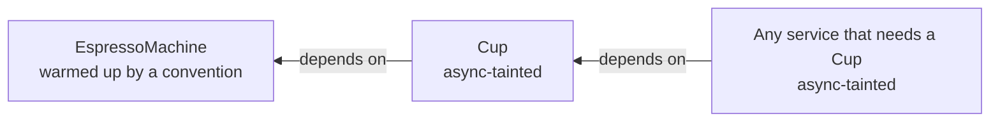

# Async initialization

Some services are not ready the moment they are constructed. An espresso machine has to heat its boiler. A payment terminal has to connect to the bank. This setup is asynchronous, and using the service before it finishes is a bug.

Awaiten treats this as a first-class concern. It tracks which services need async setup, drives that setup in the right order, and turns "you used it too early" into a compile error.

## Mark a service as async

Give the setup a name in your own domain, and tell the container about it. Declare an interface (or a base class) with a method that returns `Task` or `ValueTask`. Then add `[AsyncInitializer<T>]` to the container and name the method.

```csharp
public interface IWarmUp
{
    Task WarmUpAsync(CancellationToken cancellationToken);
}

public sealed class EspressoMachine : IWarmUp
{
    public bool IsHot { get; private set; }

    public async Task WarmUpAsync(CancellationToken cancellationToken)
    {
        await HeatBoilerAsync(cancellationToken);
        IsHot = true;
    }
}

[Container]
[AsyncInitializer<IWarmUp>(nameof(IWarmUp.WarmUpAsync))]
[Singleton<EspressoMachine>]
public static partial class CoffeeShop;
```

This is an *async initializer convention*. Every service of the container whose implementation is an `IWarmUp` is warmed up. The container awaits the method exactly once per instance, after construction and before the service is handed out. The espresso machine never references Awaiten.

The convention type is an interface or a class. The container calls the method through that type, so an explicit interface implementation or an override runs.

A service with asynchronous setup is *async-tainted*. So is any service that depends on one. Awaiten follows the taint through the whole graph.



## Pass dependencies to the initializer

The method's parameters are resolved from the graph, like the parameters of a constructor. A `CancellationToken` parameter receives the token you pass to `ResolveAsync`, `InitializeAsync` or `CreateScopeAsync`.

```csharp
public interface ICalibrated
{
    ValueTask CalibrateAsync(IClock clock, CancellationToken cancellationToken);
}

public sealed class Scale : ICalibrated
{
    public ValueTask CalibrateAsync(IClock clock, CancellationToken cancellationToken) => default;
}

[Container]
[AsyncInitializer<ICalibrated>(nameof(ICalibrated.CalibrateAsync))]
[Singleton<Clock, IClock>]
[Singleton<Scale>]
public static partial class CoffeeShop;
```

The parameters are dependencies of the service, so every graph check covers them: a missing service, a captive dependency, a cycle. A parameter may also be a relationship such as `Func<T>` or `Lazy<T>`. The method itself carries no Awaiten attributes. If you need `[FromKey]`, use an `OnActivated` hook instead.

## Use an activation hook

A convention fits a family of types. For a single registration, put the setup on the container with an `OnActivated` hook that returns `Task` or `ValueTask`.

```csharp
public sealed class PaymentTerminal : IPaymentTerminal   // no Awaiten reference
{
    public Task HandshakeAsync(CancellationToken cancellationToken) => Task.CompletedTask;
}

[Container]
[AsyncInitializer<IWarmUp>(nameof(IWarmUp.WarmUpAsync))]
[Singleton<EspressoMachine>]
[Singleton<PaymentTerminal, IPaymentTerminal>(OnActivated = nameof(ConnectAsync))]
public static partial class CoffeeShop
{
    private static Task ConnectAsync(PaymentTerminal terminal, CancellationToken cancellationToken)
        => terminal.HandshakeAsync(cancellationToken);
}
```

The container awaits the hook exactly once per instance, like a convention. Every rule on this page applies to it the same way. See [Lifecycle hooks](../06-lifetime/03-lifecycle-hooks.md#asynchronous-activation) for the hook's parameters.

## Order of several initializers

A service can match several conventions and also have a hook. All of them run, in a fixed order:

1. The `OnActivated` hook, synchronous or asynchronous.
2. Each matching convention, in the order the container declares them.

A method runs at most once per instance, even when several conventions reach it, for example through an interface that extends another.

## Which conventions apply

A registration is judged by the conventions of the container or module that declares it.

- A container's conventions apply to its own registrations.
- A module's conventions apply to the module's registrations. A container's conventions do not reach into an imported module.
- A container that [extends](../04-registration/08-extending-containers.md) a base inherits the base's conventions. They run before the container's own.

```csharp
[Module]
[AsyncInitializer<IWarmUp>(nameof(IWarmUp.WarmUpAsync))]
[Singleton<EspressoMachine>]
public static partial class BarModule;

[Container]
[Import(typeof(BarModule))]
public static partial class CoffeeShop;
```

When the module lives in another assembly, the container calls the convention itself. So the convention type and its method must be public, unless the module's assembly grants the container's assembly `InternalsVisibleTo` ([AWT234](../09-diagnostics.md#awt234)).

## Resolve it asynchronously

Use `ResolveAsync`. It constructs the service, awaits its initialization, and returns it ready to use.

```csharp
using CoffeeShop.Root shop = new();

EspressoMachine machine = await shop.ResolveAsync<EspressoMachine>(cancellationToken);
// machine.IsHot is true
```

A singleton is initialized exactly once, even under concurrent resolves. Every caller gets the same warmed instance.

## Warm everything up front

`InitializeAsync` on the root warms every async singleton ahead of time, in dependency order. A dependency is always initialized before the service that needs it. The call is idempotent and thread-safe, so calling it twice initializes nothing twice.

```csharp
await using CoffeeShop.Root shop = new();
await shop.InitializeAsync(cancellationToken);   // boiler hot, terminal connected

// later, on the hot path, resolves are ready immediately
```

This is the usual startup pattern. Warm up once when the shop opens, then serve. Under the generic host, the [MS.DI bridge](../07-hosting/01-msdi-bridge.md#warm-async-services-on-startup) does it for you during host startup:

```csharp
services.AddAwaitenContainer<CoffeeShop.Root>()
        .WithInitialization();
```

## Warm a scope

`CreateScopeAsync` opens a scope and initializes its async scoped services eagerly. If one of them throws during initialization, the half-built scope is disposed for you rather than leaked, asynchronously when `IAsyncDisposable` is available, so async-only disposables are torn down too. You get the original exception (or `OperationCanceledException`) unchanged. Only if the disposal throws as well do you get an `AggregateException` that holds the original failure first, followed by every disposal failure in one flat list.

```csharp
await using IAwaitenScope order = await shop.CreateScopeAsync(cancellationToken);
```

## Reaching an async service synchronously is a compile error

This is the point of the whole feature. In the strict default, a synchronous relationship such as `Func<T>`, `Lazy<T>` or `Owned<T>` cannot reach an async-tainted service.

```csharp expect=AWT119
public sealed class Register(Func<EspressoMachine> machine);   // build error

[Container]
[AsyncInitializer<IWarmUp>(nameof(IWarmUp.WarmUpAsync))]
[Singleton<EspressoMachine>]
[Singleton<Register>]
public static partial class CoffeeShop;
```

```text
AWT119: 'Register' resolves 'EspressoMachine' through a synchronous Func<>, but 'EspressoMachine' is async-initialized; resolve it through ResolveAsync, or set AsyncSafety.SyncAfterInit on the [Container]
```

If you do reach it at runtime, for example with `shop.Resolve<EspressoMachine>()`, `Resolve` throws with guidance toward `ResolveAsync`, and `TryResolve` reports it as not available. It never hands back an uninitialized instance.

The same rule holds for a service that is only *transitively* tainted. A `Barista` that depends on the `EspressoMachine` is async too, so it is resolved with `ResolveAsync`.

## Deferred shapes launder the taint

A synchronous service can still hold an async one, as long as it defers the work. Ask for `Task<T>`, `Func<Task<T>>`, or `Lazy<Task<T>>`, and the consumer stays synchronously resolvable.

```csharp
public sealed class Barista(
    Func<Task<EspressoMachine>> machine,   // pulled and awaited on demand
    Task<EspressoMachine> warming,         // started for you, awaited later
    Lazy<Task<EspressoMachine>> lazy)       // built once, on first use
{
    public async Task<bool> IsReadyAsync() => (await machine()).IsHot;
}

// Barista itself resolves synchronously:
Barista barista = shop.Resolve<Barista>();
```

Each shape still delivers a fully initialized machine when you await it.

## Async factories

A `Factory` method may return `Task<T>`. Awaiten awaits it, and then runs the conventions that match `T`. Add a `CancellationToken` parameter and the resolve-time token flows straight into it.

```csharp
[Container]
[Singleton<IPaymentTerminal>(Factory = nameof(ConnectAsync))]
public static partial class CoffeeShop
{
    private static async Task<IPaymentTerminal> ConnectAsync(CancellationToken cancellationToken)
    {
        PaymentTerminal terminal = new();
        await terminal.HandshakeAsync(cancellationToken);
        return terminal;
    }
}
```

A convention matches what a factory declares it returns. A synchronous factory that returns a matching type behind a plainer one hides its initialization, which Awaiten warns about ([AWT106](../09-diagnostics.md#awt106)).

## Failures are not cached

If initialization throws, the faulted result is not memoized. The next resolve builds and initializes a fresh instance. The failed instance is disposed rather than leaked, and you get the original exception unchanged. Only if its disposal throws as well do you get an `AggregateException` that holds the original failure first and the disposal failure second. A cancellation from one caller does not poison the shared singleton either. A later caller with a live token can still initialize it.

## Relax the rule when you need to

Set `AsyncSafety = AsyncSafety.SyncAfterInit` on the container to allow synchronous resolution of async services.

```csharp
[Container(AsyncSafety = AsyncSafety.SyncAfterInit)]
[AsyncInitializer<IWarmUp>(nameof(IWarmUp.WarmUpAsync))]
[Singleton<EspressoMachine>]
public static partial class CoffeeShop;
```

After `InitializeAsync` warms a singleton, `Resolve` returns that same warmed instance. If you resolve before warm-up, the synchronous path delegates to the memoizing async path, so you still get one instance, initialized exactly once, never a second uninitialized one. Use this when a framework forces a synchronous resolve on you.

:::warning[This can block]
A synchronous resolve of an async service that has not been warmed yet blocks the calling thread until its initialization finishes, because the sync path waits on the async one. Once `InitializeAsync` has warmed it, the resolve is just a cache read and does not block. So warm up at startup, and avoid a cold synchronous resolve on a thread that cannot afford to wait, or on one with a synchronization context, where blocking on async work can deadlock.
:::

## Async disposal

An async service is often async-disposable too. Dispose the container or scope with `await using`, and Awaiten awaits `DisposeAsync` on everything it owns.

```csharp
await using CoffeeShop.Root shop = new();
```

Disposing a container synchronously while it owns an `IAsyncDisposable`-only service throws at runtime, and Awaiten warns about it at compile time ([AWT156](../09-diagnostics.md#awt156)). See [Disposal](./04-disposal.md).

## Where to go next

- [Lifecycle hooks](../06-lifetime/03-lifecycle-hooks.md) for `OnActivated` and `OnRelease`.
- [Relationships](../05-resolution/02-relationships.md) for `Func`, `Lazy`, and `Task` shapes.
- [Owned](../06-lifetime/01-owned.md) for async disposable transients you rent and return.
- [MS.DI bridge](../07-hosting/01-msdi-bridge.md) to run async initialization under the generic host.
